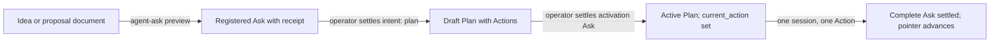

# How an idea becomes governed work

Agents have good ideas at inconvenient moments. If every idea could quietly
become work, the record of what a Project is doing would drift with each
session. If no idea could be voiced, useful
discoveries would die in a chat transcript. Arcadia resolves this by separating
asking from doing. Anyone may ask, at any time, for anything. The governed
record changes only when a request is settled: Arcadia applies exactly the
changes the request previewed, once the operator or a deterministic proof
accepts them. The operator is the person who directs the Project and holds its
approvals.

## The five pieces

**Proposal.** A captured idea with no executable work attached. It can be a
document, or an Ask with `intent: proposal`, which preserves evidence and
nothing more.

**Agent Ask.** The single door into governed state. An Ask is a small
structured request: a unique `request_id`, the Project, an `intent` naming the
kind of change, and a `desired_result`. Agents never hand-edit an
Action's status, a Decision's answer or the pointers that say what comes next.
They file an Ask, and Arcadia writes the canonical records.

**Plan.** An ordered set of Actions toward a Milestone, kept as a checked-in
document. A Plan is a `draft` until it is activated, then
`active`, and eventually `complete` or `superseded`.

**Action.** The smallest meaningful unit of intentional work. Each one carries
acceptance criteria (observable conditions that decide when it is done), a
responsibility (who may advance it: `autonomous`, `agent`, `requires_review` or
`blocked`), a concrete next step, and its dependencies.

**Decision.** A point requiring human judgment. An Ask with `intent: decision`
opens one when a reasonable person could choose differently, when the move
resists reversal, or when it names an approval boundary such as deploy, publish
or spend. Decisions sit beside the lifecycle below. An Action whose responsibility is
`requires_review` is one a coding agent must not implement, and a `complete`
Ask is refused while a required review Decision is unresolved.

Two pointers tie these together. `PROJECT.md` names the `active_plan`, and that
Plan names its `current_action`. Exactly one Action is current across a Project.

## The lifecycle

| Step | What it guarantees | What it does not do |
| --- | --- | --- |
| Capture (preview) | The request is registered, with an immutable receipt and a fingerprint of every effect settlement would have. | It writes nothing to the Project's documents or queue, and it approves nothing. |
| Plan settlement | Arcadia writes exactly the previewed effects and commits them, here a draft Plan and its Actions. | `settle --apply` never pushes; publishing the commit is a separate step. A draft does not claim the pointer, so no agent is dispatched from it. |
| Activation | Settling an `intent: plan` Ask that targets the draft with `--activate` makes the Plan active and sets `current_action` to its first Action. | It does not merge or deploy anything. |
| Completion | The Action is marked done only when every acceptance criterion is recorded as met against a named revision. | A criterion that is not met refuses the whole completion. |

Two guarantees run underneath. A receipt proves registration and grants no
approval, however urgent the Ask's wording. And capability grants nothing: an
agent that can run a command still needs the authority to run it.

## One idea, start to finish

In the Private Practice Now Project, someone wrote up a proposal for editing
the email copy on client sites, then registered it with `agent-ask preview` as
an Ask with `intent: plan`. The preview returned a receipt, and the Project's
documents did not change. The idea was safe from loss and still had no
authority.

Settling it is the operator's next step. Because the Ask has no `target_ref`,
settlement will create a complete, inactive draft Plan containing four Actions,
each with its own acceptance criteria and responsibility.

When that Plan is activated, `PROJECT.md` points at it and `current_action`
points at its first Action. A single coding session then takes that one Action,
does the work, and files a `complete` Ask whose evidence covers every
acceptance criterion, verbatim and in order, against the candidate's revision.
Settling that Ask marks the Action done and resolves what comes next: the next
Action, an open question or blocker, or a completed Plan. The operator's merge
of the pull request remains a separate gate.

The path from document to finished work has four doors: capture, plan
settlement, activation and completion. Each leaves a receipt, and each gives
the operator a clear point to say yes or no.

## What is not done

This is an unpublished draft, intended to become a guide on Arcadia Mission
Control once it meets Decision 0120's publication checks. In the example, the
capture step has happened; settlement, activation and completion describe the
governed path that follows, and this note does not claim they have run.
