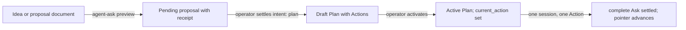

# How an idea becomes governed work

Agents have good ideas at inconvenient moments. One is halfway through a fix
when it notices a missing feature; another finishes a task and sees the next
three. If every idea could quietly become work, the record of what a Project is
doing would drift with each session. If no idea could be voiced, useful
discoveries would die in a chat transcript. Arcadia resolves this by separating
asking from doing. Anyone may ask, at any time, for anything. Only a settlement
changes the governed record.

## The five pieces

**Agent Ask.** The single door into governed state. An Ask is a small,
structured request: a unique `request_id`, the Project, an `intent` saying what
kind of change is wanted, and a `desired_result`. Agents never hand-edit an
Action's status, a Decision's answer or the pointers that say what comes next.
They file an Ask, and Arcadia writes the canonical records.

**Proposal.** A captured idea with no executable work attached. It can be a
document, or an Ask with `intent: proposal`, which preserves evidence and
nothing more. Every Ask also waits as a pending proposal until it is settled,
so "proposal" describes both the idea and the state of any request that has
not been decided yet.

**Plan.** An ordered set of Actions toward a Milestone, kept as one checked-in
document per initiative. A Plan is a `draft` until it is activated, then
`active`, and eventually `complete` or `superseded`.

**Action.** The smallest meaningful unit of intentional work. Each one carries
acceptance criteria (observable conditions that decide when it is done), a
responsibility (who may advance it: `autonomous`, `agent`, `requires_review` or
`blocked`), a concrete next step, and its dependencies.

**Decision.** A point requiring human judgment. An Ask with `intent: decision`
opens one when a reasonable person could choose differently, when the move
resists reversal, or when it names an approval boundary such as deploy, publish
or spend.

Two pointers tie these together. `PROJECT.md` names the `active_plan`, and that
Plan names its `current_action`. Exactly one Action is current across a Project.
The Agent Queue reads Actions from the checked-in Plan documents and stores only
their order; a ready Action elsewhere in that order waits for the pointer.

## The lifecycle

| Step | What it guarantees | What it does not do |
| --- | --- | --- |
| Preview | The request is registered, with an immutable receipt and a fingerprint of every effect settlement would have. | It writes nothing to the Project's documents or queue, and it approves nothing. |
| Settlement | Arcadia writes exactly the previewed effects and commits them. | It never pushes. Publishing the commit is a separate step. |
| Draft Plan | The Actions exist in a checked-in document. | A draft does not claim the pointer, so no agent is dispatched from it. |
| Activation | The Plan becomes active and `current_action` names its first Action. | It does not merge or deploy anything. |
| Completion | The Action is marked done only when every acceptance criterion is recorded as met against a named revision. | A criterion that is not met refuses the whole completion. |

Three guarantees run underneath. A receipt is proof of registration and never
proof of approval; an Ask is never self-approving, however urgent its wording.
Neither `propose` nor `apply_if_approved` lets an agent apply its own request.
And capability grants nothing: an agent that can run a command still needs the
authority to run it.

## One idea, start to finish

In the Private Practice Now Project, someone wrote up a proposal for editing
the email copy on client sites. The document by itself changed nothing.

It was then registered with `agent-ask preview` as an Ask with
`intent: plan`. The preview returned a receipt and a fingerprint, and the Project's
documents stayed exactly as they were. At that point the idea was safe from
loss and still had no authority.

The operator reviewed and settled it. Because the Ask had no `target_ref`,
settlement created a complete, inactive draft Plan containing four Actions,
each with its own acceptance criteria and responsibility.

When the operator activates that Plan, `PROJECT.md` points at it and
`current_action` points at its first Action. A single coding session then takes
that one Action, does the work, and files a `complete` Ask whose evidence covers
every acceptance criterion, verbatim and in order, against the candidate's
revision. Settling that Ask marks the Action done and resolves the next Action
in the Plan. The operator's merge of the pull request remains a separate gate.

The idea moved from a document to finished work through four doors: capture,
settlement, activation and completion. Each had a receipt, and each gave the
operator a clear point to say yes or no.

## What is not done

This note explains the workflow; it is a draft and has not been published to
Arcadia Mission Control, where it is intended to become a guide. The worked
example was supplied by the operator. Its capture and draft-Plan steps are
described as they happened; the activation and completion steps describe the
governed path that follows, and this note does not claim they have run. Command names and fields here reflect the
repository at the revision pinned in the receipt; `arcadia agent-ask contract`
prints the live schema if the two ever disagree.
