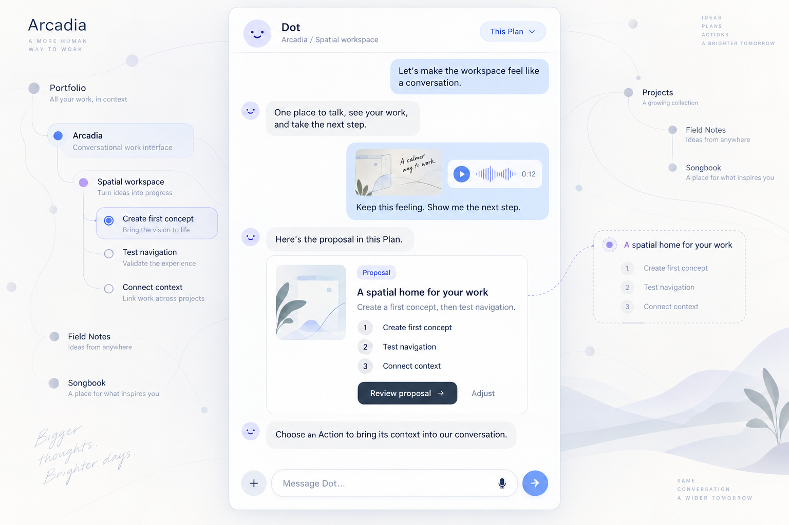
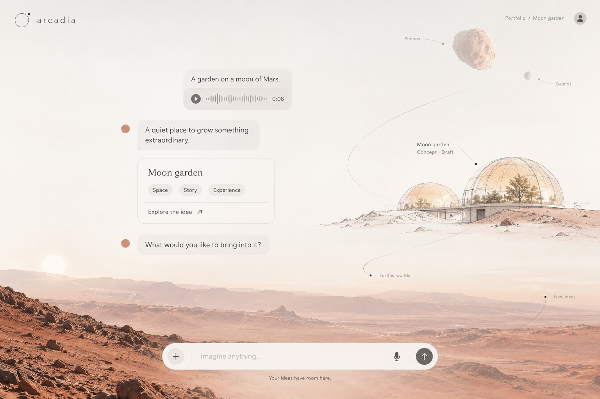
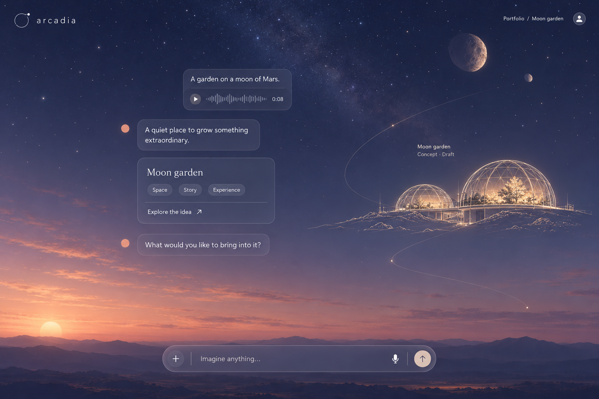
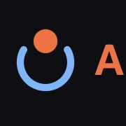
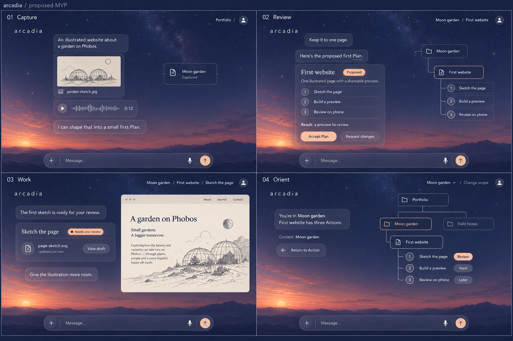
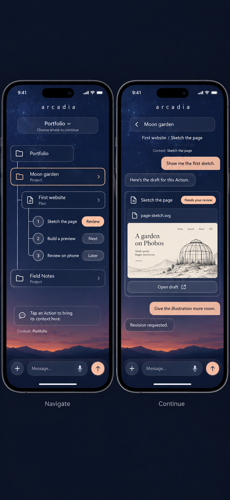
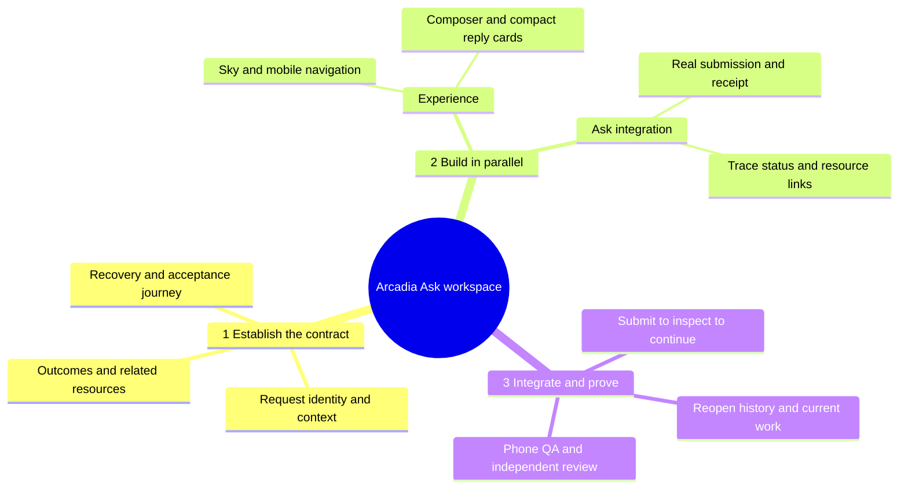

# Arcadia conversational workspace UX design specification

## Verified delivery status — 2026-10-15

The [routing and React sky scaffold](https://github.com/pmark/arcadia/pull/1427) is merged, following independent current-head review and seven passing CI jobs. It provides `/workspace`, Project/Plan/Action routes, readable scope navigation, and responsive extension regions. It does **not** yet submit Ask requests or supply conversation history. The [Ask API scenario suite](https://github.com/pmark/arcadia/pull/1422) is also merged; its disposable-workspace evidence does not prove deployed latency or worker execution.

The imagery below consists of design concepts, not screenshots of shipped features. Actual scaffold captures are [phone](../../assets/arcadia-conversational-workspace/workspace-shell-phone.png) and [desktop](../../assets/arcadia-conversational-workspace/workspace-shell-desktop.png). Shared services were not restarted and no deployment is claimed. The [next integration handoff](../reports/handoffs/20261015T0621Z-01a13dbc-5c50-7ef1-b48b-a9678ff4fb9b.md) records the remaining contract, tests and coordination hold.

Status: working design draft, 14 October 2026.

This is the living design deliverable for the session. It brings the conversation, visual explorations, operator feedback, and proposed interaction rules into one place. It will develop into the specification for a prototype as the design becomes more concrete.

**One conversation. The right interface appears where you need it. Your surroundings keep the context.**

The workspace should feel quiet, calm, refreshingly simple, and open to any bespoke creation imaginable. Someone can arrive with an unfinished thought, a voice message, an attachment, or a specific request. Arcadia helps the work take shape without making them navigate the system's internal organization first.

The companion [article](../articles/2026-10-14-arcadia-spatial-background.md) explains the experience for readers. This specification guides product design and prototype evaluation.

## Design direction established in this session

These are operator preferences and design directions expressed in this conversation. They are not implementation approvals or governed Project Decisions.

| Area | Direction | Status |
| --- | --- | --- |
| Primary experience | Familiar text messaging, with the ease and multimedia capability of native iPhone or Android messaging | Operator requested |
| Tools | Bring relevant dashboard views, menus, systems, and protocols into the conversation | Operator requested; individual interactions need design |
| Spatial context | A lightweight vector hierarchy that moves smoothly and suggests depth | Operator requested; SVG is the preferred starting direction |
| Environment | Reuse Mission Control's existing animated sky verbatim; adapt Astro integration to React | Operator required; source traced and pinned |
| Tone | Quiet, calm, refreshingly simple, versatile, and creatively ambitious | Operator requested |
| Wordmark | Keep exploring the lowercase arcadia treatment in the concepts | Operator explicitly liked it; exact typeface is unresolved |
| Symbol | Simple, friendly, unpretentious; explore the spirit of the supplied reference | Operator preference; final mark is unresolved |
| Orbit symbol | Move away from the generated planetary orbit mark | Operator disliked it as overdone |

## The foreground is a conversation

Messaging is the primary interaction. Text, voice, images, and other attachments belong naturally in the same thread. The composer should be immediately recognizable and available without searching for it.

When a request needs more than a reply, the relevant interface appears within or directly beside the conversation. A proposal can have a review card. A choice can have a compact menu with consequences. An Action can show its progress or evidence. A creation can have an appropriate preview and editing controls. Reuse useful dashboard capabilities through contextual views rather than reproduce the whole dashboard at once.

Reveal only the controls needed for the immediate task, with an obvious route to more detail. Keep the dialogue readable while a view is open, and preserve the work when that view is dismissed. A reopened view should reflect its current underlying record.

The operator described the conversational experience through Dot. Assistant naming and branding remain open; the concept images use “Dot” as an exploration, without establishing an OpenAI product integration.

## The background carries orientation

The spatial layer shows where the selected work belongs. Start with Action → Plan → Project → portfolio. Additional Arcadia entities should follow their actual relationships rather than being forced into this illustrative chain.

A proposal softly appears near the work being discussed. Clarification makes its content and intended relationships more definite. Acceptance through the actual proposal process lets it settle into the hierarchy as an Action. Keep the idea visually recognizable through that transition. Appearance must reflect recorded state; a decorative animation cannot imply approval or execution.

Pulling back reveals neighboring Actions, then the Plan's place in the Project, then the Project's place in the portfolio. Scale, coordinated movement, and restrained parallax suggest depth through a two-dimensional vector scene. Maintain stable spatial relationships so people can learn where things live.

Containment, sequence, and dependencies need distinct visual treatments. Distant work becomes a summary; details emerge as the view approaches. Selection and important state must remain understandable without color alone.

## Navigation establishes conversational scope

The operator's central idea is that context loads because you navigate to it. The proposed interaction makes deliberate selection establish scope, while free camera movement remains exploratory. This distinction needs prototype validation.

Show a compact readable scope path and let the person change or inspect it. In a selected Plan, “add a step before this one” should refer to its selected Action. At Project scope, “what should happen next?” should use that Project's relevant records.

Changing scope should preserve the conversation and make the new reference clear. If a request ambiguously crosses Projects, ask a concise clarification before affecting work. Loading context means selecting relevant records within a bounded context budget, not loading the entire portfolio into every model request.

## Unified UX with flexible context navigation

The operator endorsed this principle after reviewing the iPhone concept: minimize conversation threads while keeping history immediately accessible. People navigate the entities that structure their desired outcomes, rather than an endless list of chat sessions.

The primary navigation follows the work: Project, Plan, Action, and their relevant relationships. Conversation is a continuous interaction surface over that structure. Moving between entities should not require creating, naming, finding, or managing a new chat session. Internal model sessions may exist without becoming the user's organizing system.

### History belongs within reach of the work

The proposed interaction keeps a compact History control beside the scope path. Selecting it reveals earlier exchanges related to the selected entity, with search and a clear way to broaden to its parent or the portfolio. Each result shows its date, source scope, and enough surrounding conversation to understand it. Opening a result returns to the original exchange and associated attachments or artifact references, with a route back to the current conversation.

An exchange may relate to several entities. Refer to the same original exchange from each relevant place instead of creating duplicate conversations. Preserve the scope in which a message was sent even when the current selection changes. Keep conversations and recorded work state distinct: a past message is evidence of what was said, not proof that the present record has that state.

A lightweight continuation summary may orient the person when entering an entity, but the original exchanges remain immediately reachable. Avoid forcing the person to read a long transcript before continuing. History can remain available without injecting every old message into the active model context.

### Interaction requirements for the prototype

- Changing context preserves the current draft and makes the new scope visible before sending; an attachment stays associated with its unsent message. If a scope change would make a draft ambiguous, keep its original scope explicit until the person chooses to retarget it.
- Returning to an entity restores the prior reading position or offers a clear way to resume it.
- Earlier dialogue, decisions, attachments, and artifact references are accessible from that entity through one obvious history entry point. Historical artifact references identify the version discussed where available.
- Search can start within the selected entity and expand deliberately. Results identify their original context.
- A discussion spanning multiple entities remains traceable without forcing another user-managed thread.
- Creating a separate conversation is an exceptional deliberate choice whose use case still needs design; it is not the default consequence of navigation.

The principle is established by operator feedback. The History control, search behavior, linking model, and restoration rules above are designer proposals for validation, not implemented capabilities. The next phone concept should expose the history entry point without crowding the scope header.

## One sky and one workspace

**Use the existing sky verbatim.** The repository powering ArcadiaMissionControl.com is now located and its renderer traced. Preserve its two Canvas 2D layers, phase helpers, seeded stars, colors and motion; adapt only lifecycle, refs, theme/property ownership and integration for React. Do not replace it with a simplified CSS approximation or redraw it in SVG. The portfolio hierarchy remains an independent SVG/DOM layer above the sky.

See [Mission Control sky React reuse](mission-control-sky-react-reuse.md) for pinned source files, the existing ten-minute simulated-sol behavior and visual-parity acceptance. The source includes the Sun and evening Earth; moons/clouds in generated concepts are exploratory imagery, not properties of the renderer. Live deployed parity has not been verified.

Integrate the spatial layer and foreground with Mission Control's existing animated sky. The day and night cycle is the shared environment. Stars and sky provide atmosphere; work nodes and connections provide orientation. They should be visually distinguishable.

The latest concept explores twilight: restrained translucent surfaces, readable light text, and warm fine linework. The interface must also remain readable in daylight and full night. Its surfaces may adapt to ambient brightness, but text contrast and control recognition take precedence over transparency.

Keep sky movement slow and unobtrusive. Let hierarchy movement explain navigation or a state change. Provide a quiet reduced-motion presentation with stable orientation. Preserve useful rendering on phones; expensive blur, continuous hierarchy animation, and dense visible nodes require evidence before adoption.

Phobos, Deimos, and the Moon garden are creative examples from this session, not required fixtures in every workspace. The product should support a story, software, a service, an object, music, or another creation without forcing a celestial theme onto the content.

## Identity

Retain the lowercase arcadia direction: approachable, restrained, and confident. The generated lettering is a visual reference rather than a selected font asset.

Explore a small, simple symbol with the friendliness and economy of the operator's reference: a warm dot and an open blue shape. Its exact geometry, colors, and resemblance to a person remain open. The reference establishes a preference, not a final logo selection.

Avoid planetary rings and orbit metaphors in the mark. Let the sky carry the sense of wonder. Evaluate the identity at small sizes, in monochrome, and against both daytime and nighttime backgrounds. A wordmark-only version is a designer proposal worth comparing.

## Concept images and feedback

These are generated raster explorations, not working screens or SVG deliverables. They illustrate direction; their individual controls, wording, layouts, and visual details are not automatically accepted requirements.

### Messaging with spatial context

Establishes the conversation, attachments, inline proposal card, and surrounding hierarchy. Later discussion moves the visual environment toward Mission Control's sky.

### A quiet creative space

Explores calm, generous space and a bespoke creation taking shape near the conversation. The literal Martian landscape is superseded by the request to integrate with Mission Control's existing background.

### Integration with the sky

The operator called this an excellent start and explicitly liked the lowercase wordmark. The orbit symbol is rejected. This image was based on a description of the background; exact visual integration with the existing application remains unverified.

### Operator identity reference

The operator favors its simpler, less pretentious spirit while remaining open to another final design.

## Broader MVP vision through four views

This contact sheet illustrates the broader intended experience. The required first functional slice is the real Ask submission-to-result loop below; decorative previews and unsupported capabilities may remain clearly staged. All four views use the same fictional Project, Moon garden: an illustrated website about a garden on Phobos. Its Plan, First website, contains Sketch the page, Build a preview, and Review on phone. The image shows hypothetical features, not an implemented application. Screen three is a later state after Plan acceptance and draft creation; acceptance alone does not imply an artifact exists.

| View | What the person can do | What the prototype must demonstrate |
| --- | --- | --- |
| Capture | Send text, a reference image, and a voice note in one conversation | Preserve the submitted content, show capture state, and keep a familiar composer available |
| Review | Inspect the proposed result and three Actions; accept the Plan or request changes | Keep proposed state explicit, preserve requested revisions, and reflect the real acceptance result |
| Work | See the current Action, open its draft artifact, and request a revision through chat | Associate the correct artifact and review state with its Action; preserve feedback and distinguish a submitted revision request from a completed revision |
| Orient | View the selected Project within its portfolio, inspect its Plan and Actions, change scope, and return to the Action | Preserve the conversation and selection while changing scale; make the scope used by the next message explicit |

The shared shell consists of the lowercase wordmark, scope path, conversation, composer, and continuous sky. Contextual cards, artifact previews, and the map appear when useful. These are phases of one workspace rather than separate application modes. The prototype first uses fixtures for proposal and artifact states; real record and execution integration is a separate validation step.

The proposed MVP includes multimedia capture, one structured Plan proposal view, one Action/artifact review view, and hierarchy navigation with explicit scope. It does not promise a universal editor, arbitrary creation automation, automatic publication, or every dashboard view. Additional contextual views should follow demonstrated needs after this journey works.

The contact sheet holds the sky at twilight to compare functionality consistently. Daytime, nighttime, reduced motion, mobile layout, loading, failure, and empty states still need separate design. The hierarchy's pictured status labels are illustrative; final labels must map to the underlying record states. “Accept Plan” must use the actual acceptance path and must not silently approve execution or publication. The wordmark-only header is a designer exploration, not a final identity decision.

## Mobile navigation and continuity across devices

The operator approved the four-view direction and requested an iPhone exploration of portfolio navigation. They also established the ambition that the same simple experience should translate to VR, AR, XR, and future human-computer interaction. This is a portability goal, not a claim of compatibility or a commitment to implement those platforms in the MVP.

The shared interaction is: navigate to work, deliberately select its context, then interact naturally through language and attachments. Preserve the meaning of location, selected scope, records, and conversation across devices while adapting presentation and input to each medium.

The mobile concept shows two moments of that experience. Navigate presents a vertical connected branch, with readable parent and child relationships, rather than a miniature desktop map. Continue shows the selected Action's conversation and inline draft preview. A persistent composer and a route back to the parent keep the interaction familiar. The same Project, Plan, Actions, sky, typography, and selection treatment carry across desktop and phone.

This is a designer proposal. The left image's warm Project outline indicates the expanded browsing branch while the explicit conversation scope remains Portfolio. The difference between expanded branch and selected conversational context needs a clearer visual treatment or a simpler unified selection rule in the next prototype. Selecting an Action should make the resulting scope unmistakable. Returning to the tree should preserve the conversation and navigation position.

Validate long labels, larger text, scroll behavior, keyboard appearance, safe areas, one-handed reach, accessible tree semantics, attachment capture, and whether a full hierarchy must remain visible while chatting. The generated image does not prove touch target sizes, accessibility, or responsive implementation. Spatial versions should later test equivalents for selecting, returning, reading scope, and speaking or attaching content without assuming a phone layout can simply float in a headset.

## The first prototype story

1. Arrive in a calm workspace with an immediately usable message composer and visible scope.
2. Speak or type an idea and attach a reference.
3. See a proposal appear in the conversation and spatial context, visibly identified as proposed.
4. Inspect or adjust it through the relevant inline view.
5. After acceptance through the real process, follow its transition into an Action.
6. Pull back through its Plan and Project to the portfolio, then return without losing the conversation.
7. Select another scope and verify that the next request uses the expected context.

Evaluate whether a person can identify their scope, understand the proposal's state, find the next useful interaction, and recover their place after navigation. Check the same story on a phone and desktop, across day, twilight, and night, with keyboard access and reduced motion. Performance and resource targets need explicit device and portfolio-size baselines before implementation acceptance.

## Required MVP loop through Arcadia Ask

The operator clarified a non-negotiable product requirement: if the bottom composer is offered as Arcadia Ask, its real routines and results must integrate with the whole experience. A local notebook with staged assistant replies does not satisfy that requirement. The earlier notebook proposal is superseded as the recommended MVP.

**Submit → understand what happened → open the relevant work → continue in context.** The assistant's brief replies connect the parts of the system into one understandable experience. This is essential product behavior, not decorative copy.

### One complete feature

Submit a real text Ask through the existing intake path, retain its request identity and submitted context, show a concise truthful response, and immediately expose navigation to all related work, processes, Decisions and available Artifacts. Follow the request as its real state changes and make the trail easy to reopen from its associated entities. The first supported end-to-end Ask outcome can be bounded; unsupported outcomes still need a truthful response and a usable next route.

The existing source provides useful seams: POST /api/ask delegates to runAsk and returns result.summary plus structured references (apps/dashboard/app/api/ask/route.ts; lib/types.ts:252). GET /api/ask/show retrieves the Ask trail (app/api/ask/show/route.ts; lib/arcadia-cli.ts:52). These do not yet prove complete linked-artifact discovery, contextual routing or ongoing UI updates. Those are implementation obligations to assess, not assumed working features.

### Response and navigation contract

| Moment | Required visible behavior |
| --- | --- |
| Sending | Preserve the message; show pending receipt, not a claim that work has begun |
| Ask returns | Give a brief plain-language summary grounded in its receipt, including actual destination and state |
| Work exists | Offer compact contextual links/cards for every returned related item, Run, review/Decision and available Artifact; expand details on demand |
| Work is pending | Say captured, queued, running or awaiting review only when supported; open the relevant process/status view even if no Artifact exists yet |
| Artifact becomes available | Expose it through the same request and related entity, identify the relevant version when available, and retain a route to the producing work |
| A decision is needed | State the question and consequence clearly; expose the existing governed decision view rather than imply chat automatically approved it |
| Failure or ambiguous delivery | Retain text and request correlation, distinguish failed submission from failure after capture, and offer a recoverable next step; verify retry/idempotency semantics before enabling automatic resend |
| Returning later | Reopen original request, its reply and current linked state from entity history, preserving original timestamps and scope |

“Immediately accessible” means the receipt and links to existing resources appear as soon as known. It does not mean future artifacts already exist or every request starts execution. If there are no active processes or artifacts, say so concisely. The related resources become additional context-navigation destinations, not a proliferation of separate chats.

### Brief replies that hold the experience together

Use a calm, concise voice: what was understood, what actually happened, and the useful next place to go. The first implementation should render Ask's existing summary and state-derived follow-ups. It need not introduce another model call merely to narrate the receipt. Richer conversational synthesis can follow when it demonstrably adds value.

Illustrative wording, conditional on real receipts:

- “Captured for Moon garden. Open the request to see its next step.”
- “This needs your review. Here is the Decision and the proposed work.”
- “The Run is queued. Follow its progress here; no draft is available yet.”
- “A draft is ready. Open it here, or return to the Action.”

Keep the original reply as history while showing current status separately. Do not rewrite the past exchange as though it originally knew later results. This is a Dot-like interaction direction, not a claim of an OpenAI product integration.

### Context and safe integration

The visible selected entity expresses the user's intended scope. The inspected Ask HTTP contract currently accepts text and requestId, not a structured selected-entity field. Implementation must establish a supported, validated routing contract before promising that navigating selects Ask's actual destination. Never rely on invisibly prepending instructions to user text or show the selected Project as the actual destination when the receipt differs. Preserve the original input and report routing mismatch clearly.

Read existing canonical receipts for current state; do not introduce a competing execution-state store. Browser storage may cache draft text and UI position, but must not substitute for captured Ask history or claim submission success. Initial status refresh can reuse existing read paths with bounded refresh while relevant; exact Run/Artifact links and fallbacks require verification. No new orchestration or automatic authority is implied.

### Three checkpoints and parallel work

After agreeing the shared request/result contract, visual components and the Ask adapter/status projection are technically separable. Use disjoint ownership and authorized isolated candidates; one owner integrates the final flow. Contract and failure-case tests can be prepared alongside the shell. Final acceptance must exercise the real integrated submission path with safe test inputs, not only fixture messages.

One or two calendar days remains a target, not a calibrated forecast. The notebook-only 10–16-hour judgment does not estimate this revised requirement. Inspect the safe context field, request-trail resource coverage and current-state refresh path first; then forecast using actual production timings. Keep the sky/rendering and optional preview content simple to protect this real loop. Multimedia processing, general creation automation, advanced graph effects and richer AI narration can be staged or deferred explicitly; a fake Ask composer cannot stand in for the real feature.

## Questions to resolve as the design develops

- How should the verbatim Mission Control renderer connect to the opted-in React shell and conversation scroll container while preserving visual parity?
- How should chat and creation previews share space on a phone?
- Which few existing dashboard views best prove the conversational model first?
- What changes scope: selecting a node, entering a view, or another explicit gesture?
- What is the clearest compact History entry point, and how should results spanning multiple entities appear without duplicating conversations?
- Which exact typeface and simple mark should advance to identity testing?

These are a design backlog, not a request for the operator to answer everything now.

## What is not done

This is the first specification draft. It records the current conversation and makes designer proposals explicit. Exact typography, logo geometry, responsive layouts, interaction states, accessibility behavior, animation timings, performance budgets, and integration with the existing application still need design and validation.

The next design pass should inspect the existing sky and explore a simpler identity on the selected concept, followed by the phone layout and the prototype story above. Keep new feedback here as the document evolves; the final session handoff should distinguish settled design direction, remaining questions, and prototype-ready requirements.
