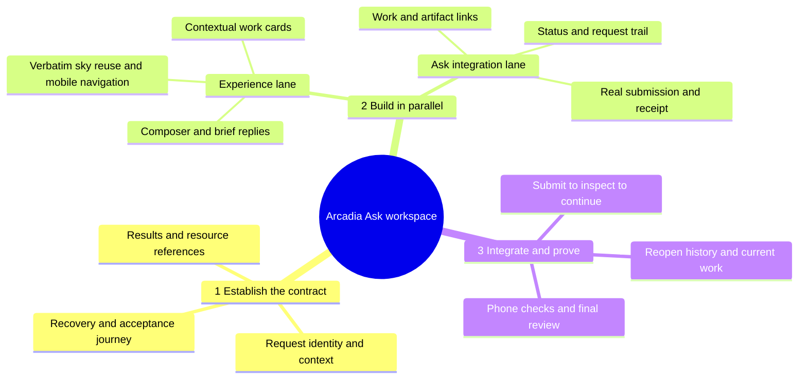

# Arcadia Ask workspace delivery map

**Required real feature: submit an Ask, understand its result, open all related work and available artifacts, and continue in context.** A notes-only composer does not satisfy the operator's clarified requirement.

## Core behavior

The composer submits through Arcadia Ask. A brief response explains the actual result and offers immediate links to associated Actions, Plans, Runs, Decisions and Artifacts when they exist. Work in progress remains inspectable before it produces artifacts. Resources appear as context destinations within the unified experience.

Reuse the existing summary and structured receipt before considering a separate model call for narration. Preserve original reply history and distinguish it from current status. Handle pending, captured, queued, review-required and failed states honestly. Verify context routing, safe retries and resource-trail coverage rather than assuming them from the presence of an Ask endpoint.

## Parallelism and timing

Agree the shared contract first. Visual shell/components and Ask adapter/status projection can then proceed as two disjoint work packages with authorized isolated ownership. One owner integrates; final acceptance and review verify the actual combined result. Continuous production removes idle handoff gaps but not dependencies.

One or two calendar days is a target. Earlier numerical estimates were uncalibrated judgments; the notes-only estimate does not apply to this revised requirement. Reforecast after bounded integration discovery and an actual representative delivery cycle.

The previous contextual-notebook recommendation is superseded. Supporting visual previews, attachment processing and advanced navigation may be staged explicitly; **the Ask loop itself must work**.

See the [specification](arcadia-conversational-workspace.md) for the response contract and the [technical analysis](arcadia-mvp-80-20-technical-analysis.md) for source findings and remaining integration questions. No production launch or pointer change is authorized by these documents.

Background reuse is now source-backed: preserve the existing two-canvas renderer from the public site, adapting Astro lifecycle integration to React. See [source map and parity checklist](mission-control-sky-react-reuse.md). Do not budget a new sky design or a CSS approximation.
