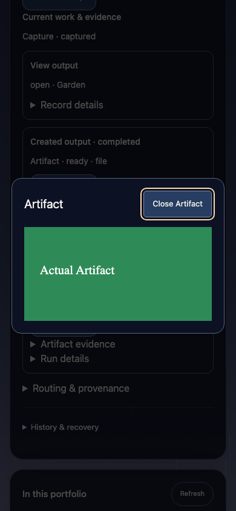
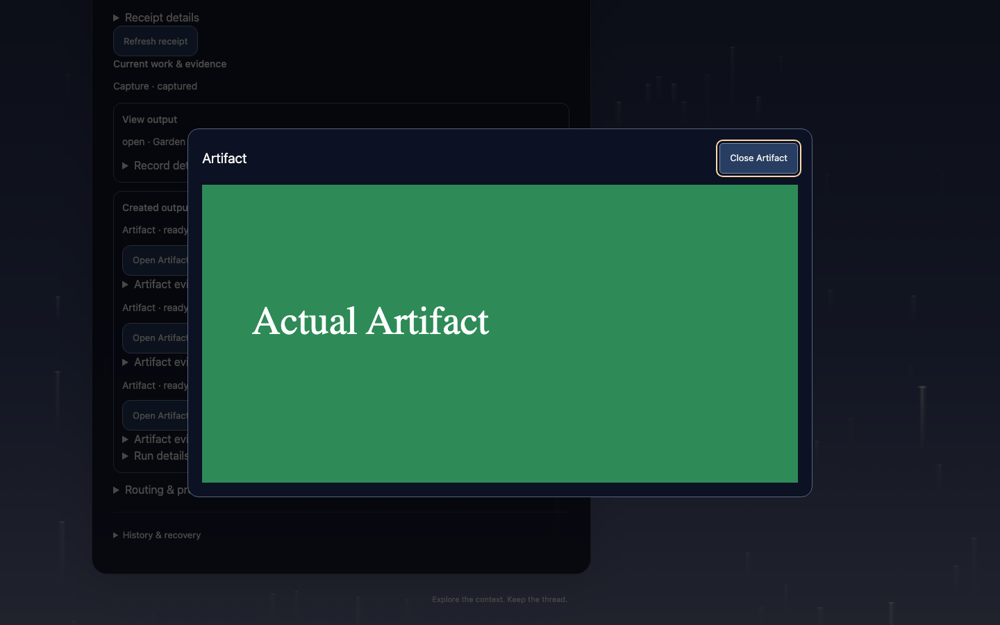
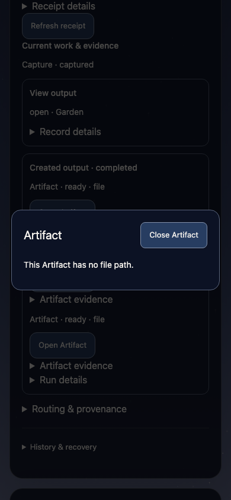

# Open linked workspace Artifacts

Operator-directed request #1441; no governed Action is claimed. Project: Arcadia.
Milestone: the Project's existing unattended-production milestone is unchanged;
this direct product slice does not execute its current Action
`claude-worker-launch-replay` (read to rule out overlap).

Assigned implementer: Cody Atlas (codex/heavy, builder), native depth 1,
GPT-6.1-Sol at native medium / `e2_standard`; no delegates. Lead owns independent
review and delivery, with product writes paused during this assignment.
Candidate: `codex/workspace-artifact-open`, base
`7d3b7eda9d2226e24f2abcbce104c9adc55a0db6`.
Budget: one focused implementation pass; no provider calls, spend, service
restart, production mutation, governance settlement, commit or push by the
implementer. Monitor receipt: `/tmp/workspace-artifact-monitor.json` (Lead).

## Product contract

Each Run-linked domain Artifact card has one **Open Artifact** button. The native
modal displays real SVG/PNG/JPEG/WebP bytes as an image resource, or UTF-8 text
(`txt`, `md`, `json`, `csv`, `tsv`, `log`, `yaml`, `yml`) in an escaped `pre`.
Close and Escape restore focus to the opener without writing draft, target,
receipt, history, or URL state. Loading and file errors stay in the viewer.

The route is `GET /api/workspace/artifacts/:id?receipt=:receipt`. It accepts no
client path/root/workspace selector. It resolves the configured workspace, reuses
`runAskTrailCommand`, then reads the domain Artifact and Project metadata through
`withReadOnlyDatabase`. A Run from that receipt must link the Artifact, and the
Artifact must name the Run's owning Project. Intelligence blob IDs and endpoints
are separate concepts.

Persisted relative paths resolve from the workspace, matching
`src/commands/artifact.ts`'s `resolveArtifactInputPath`; absolute persisted paths
are supported. Only canonical workspace `artifacts/` and the owning Project's
configured `repo_path` are allowed roots. Root mappings of `/`, relative mappings,
missing mappings, paths outside these roots, missing/pathless records, symlink
escapes and nonfiles grant no fallback. Read-only/nonblocking/nofollow opens plus
canonical path and inode checks detect certain changes during opening. A bounded read of
at most 4 MiB plus one byte and a final stat enforce the cap even after growth.
UTF-8 is decoded strictly; binary text, invalid image signatures, unsupported
extensions and SVG DTD/entity declarations are refused.

This is a local single-operator dashboard with no authentication layer. Receipt
correlation and filesystem checks are relational/path guardrails, not an
authenticated ACL. SVG is rendered only through `img`'s secure image context,
never injected markup, iframe, or HTML. Direct byte responses also set CSP
`sandbox; default-src 'none'; style-src 'unsafe-inline'; base-uri 'none';
frame-ancestors 'none'`, `nosniff`, and `no-store`. Text is plain MIME and React
escapes its viewer content. No dependency, schema, provider, backend service,
or shared CLI bridge changes are needed.

## Validation receipts

Deterministic evidence is recorded below. Independent review and delivery remain with the Lead.

- `pnpm exec vitest run tests/workspace-artifact-route.test.ts`: final 9/9 passing; `/tmp/workspace-artifact-route-tests-4.log`. Earlier 8/8 pass is in `-3.log`; the later pass adds file-growth coverage.
- `pnpm build`: exit 0, repository lint + root TypeScript + Discord build; `/tmp/workspace-artifact-core-build.log`.
- `pnpm --filter arcadia-dashboard build`: exit 0; dynamic route appears in production output; `/tmp/workspace-artifact-dashboard-build.log`.
- `pnpm exec playwright test tests/e2e/workspace-artifact.spec.ts`: final exit 0, 1/1 passing (5.3s); `/tmp/workspace-artifact-browser-2.log`. Production next start served a disposable workspace's actual byte route (3 reads); Ask/nav mocked; zero POSTs. Browser observed natural image width 240, no external SVG sentinel request or script flag, literal escaped text, pathless error, exact URL/storage/draft preservation and restored opener focus.
- Visually inspected deliberately positioned viewport captures at 390×844 and 1440×900, plus phone error state: `test-results/playwright/workspace-artifact-opens-r-430c7-ne-without-changing-the-Ask/artifact-phone.png`, `artifact-desktop.png`, `artifact-error-phone.png`. They are ignored QA output, not repository assets. Each test attaches its temporary Next server log before cleanup.
- `cd apps/dashboard && pnpm exec tsc --noEmit --listFiles`: exit 2, eight diagnostics in unchanged test files (operator-script route test, pull-request-audio test, pull-request-inventory-client test, pull-request-summary test). No touched product-file diagnostic. Full list and source reachability retained at `/tmp/workspace-artifact-dashboard-tsc.log`; source-backed server imports are isolated to the dedicated Artifact helper, with the shared CLI bridge unchanged. The standalone check is not claimed green.

- Focused route test source: `tests/workspace-artifact-route.test.ts`.
  Real disposable schema/database/SVG/file bytes; no mock of Ask correlation.
- Browser source: `tests/e2e/workspace-artifact.spec.ts`.
  Production `next start`; disposable server workspace; only navigation and Ask
  reads mocked, actual new Artifact HTTP route used.
- Loaded learning receipt `/tmp/workspace-artifact-lessons.json` has no matches.
  New fixture failure query `/tmp/workspace-artifact-fixture-lessons.json` also
  returned none through source-backed read-only `runLearnSearchCommand`.

## Friction and limits

- Initial candidate writes were denied by the workspace sandbox (candidate is
  outside its writable roots). The same assigned scoped writes succeeded through
  ordinary host permission escalation; no workaround path or primary edit.
- Initial disposable fixture incorrectly registered a repository outside the
  experiment `projects/` root. The experiment guard refused it. The source fixture
  now puts its repository inside `workspace/projects/garden`; failed output is
  `/tmp/workspace-artifact-route-tests.log`.
- The next fixture attempt used `captured` as an Ask request status, which the
  canonical repository rejects. Corrected to `planned`; failed output is
  `/tmp/workspace-artifact-route-tests-2.log`. Fixture cleanup now tolerates setup
  failure. No product relaxation was made for either fixture failure.
- The first browser run expected Tab to immediately wrap onto the modal's only button. Native Chromium yielded a browser-chrome/body Tab stop instead; initial close focus and actual SVG rendering had passed. The corrected test permits browser chrome while requiring a modal dialog and no background-control focus, then proves Escape and opener restoration. No product focus framework was added. Failed log `/tmp/workspace-artifact-browser.log`, screenshot `/tmp/workspace-artifact-focus-failed.png`, and context `/tmp/workspace-artifact-focus-failed-context.md` are retained. The targeted notes and retained-lesson search had no relevant matches (`/tmp/workspace-artifact-focus-lessons.json`).
- Generic legacy file-route lexical containment is out of scope; Lead retained
  Issue #1442. This route independently checks canonical roots.
- No live operator output was opened, and no LAN/phone reachability is claimed;
  the phone proof is a 390 px browser viewport on loopback.

## Operator and end-user QA

After delivery, start the dashboard normally with `pnpm --filter arcadia-dashboard
start` after core and dashboard builds. Default URL: `http://localhost:3020/workspace`.
The implementer fixture proves loopback only; this change does not establish any
LAN/remote deployment. Operator and end-user steps are the same:

1. Select the intended Project/Plan/Action and retain an unsent draft. Inspect an
   Ask receipt whose Run links a supported existing domain Artifact.
2. Select **Open Artifact** on its card. The image or readable text appears in
   the modal. Inspect it at phone width; the output fits the viewport.
3. Close the modal or press Escape. The same selected context, draft and receipt
   remain, and focus returns to the opener. No Ask is submitted.
4. Open a pathless, missing, oversized or unsupported linked output. A clear file
   error appears; closing it preserves the same state.

## Retrieved instruction inventory

Lengths are whole-file UTF-8 bytes; targeted retrieval covers the sections below,
not a claim that every section in a large reference was loaded. Session brief:
`/tmp/workspace-artifact-implementer-brief.json`, `data.text`, read in full.

| Path | Bytes |
| --- | ---: |
| `AGENTS.md` | 10118 |
| `CONSTITUTION.md` | 3320 |
| `PROJECT.md` | 31677 |
| `.arcadia/AGENT_CONTEXT_POLICY.md` | 539 |
| `.arcadia/repo-context.md` | 703 |
| `.arcadia/context-policy.json` | 870 |
| `docs/agent-guidance/index.json` | 9449 |
| `.agents/skills/arcadia-role/SKILL.md` | 8539 |
| `.agents/skills/arcadia-guardrail/SKILL.md` | 5565 |
| `docs/agent-guidance/learning.md` | 2458 |
| `docs/agent-guidance/operator-directed-work.md` | 4494 |
| `docs/agent-guidance/standard-harness.md` | 5569 |
| `docs/agent-guidance/continuation.md` | 7256 |
| `docs/agent-guidance/session-roles-and-briefs.md` | 6152 |
| `docs/AGENT_ORIENTATION.md` | 13594 |
| `docs/arcadia-semantics.md` | 15647 |
| `docs/agent-guidance/arcadia-repository.md` | 30174 |
| `docs/working-copy-safety.md` | 16202 |
| `docs/agent-guidance/pull-requests.md` | 17585 |
| `docs/notes-to-self.md` | 38716 |
| `tests/fast-rehearsal/README.md` | 20898 |
| `tests/fast-rehearsal/helpers/environment.ts` | 8967 |
| `scripts/fast-rehearsal.mjs` | 5737 |
| `docs/plans/arcadia-runs-production-unattended-on-its-own-repository-on-the-claude-provider.md` | 12400 |

Targeted sections: active Plan current Action lines 30–49; repository Orientation,
Semantics, Operator Guide, PR QA Plan, Working-Copy Safety, Experiment workspaces;
working-copy Start-session and Stop-session; PR Make it real and Token economy;
notes Ask traceability, protected read-only workspace, dependency bridge, rehearsal
fixture isolation; fast-rehearsal Run it, real/faked seams and isolation.

## Final validation and handback

- Unmodified `node scripts/fast-rehearsal.mjs`: exit 0, 19 files passed,
  72 tests passed and one expected failure; 34 scenarios, 253075 ms wall.
  Raw `/tmp/workspace-artifact-fast-rehearsal.log`; report exists at
  `/var/folders/cm/0dn1wl093f52lr7h5d7xpdn40000gn/T/arcadia-fast-rehearsal-report-vi44tG/report.json`.
  Validators: unsandboxed and Seatbelt. The report records 49 errors, with two
  labelled unexpected: the deliberately injected `session-probe-wall` EROFS
  lifecycle log/launch events (`tests/fast-rehearsal/session-probe-wall.test.ts`
  lines 10–48). The existing #1322 report-classification caveat is retained;
  this is a passing test run, not an error-free rehearsal report. The expected
  failure remains the unchanged expired-Grant admission case for #1012.
- Final touched-file ESLint: exit 0, `/tmp/workspace-artifact-final-lint.log`.
  This includes the browser fixture's corrected native Tab assertion.
- `git diff --check`: exit 0. Builds did not add tracked generated-file changes.
- No service remains running from the browser proof; its tracked process is
  stopped in `finally` and its disposable workspace is removed after log attachment.

Per-criterion deterministic evidence is complete within the stated limits.
The implementer returns product-file write ownership to the Lead; no further
writes, checks, or processes are pending. The Lead owns exact-head independent
review, START_HERE/session ledger updates, commit/push, PR handoff and required
checks. No governed Action/queue/Plan state was changed, and no implementation
commit, push, external message, host broker or deployment was performed by this delegate.
The next safe move is the Lead's independent review/delivery path; stop at a
blocking current-head finding or an external authority boundary.

### Final source SHA-256

| Path | SHA-256 |
| --- | --- |
| `apps/dashboard/app/api/workspace/artifacts/[id]/route.ts` | `1d3fa3e11238825cd63fb62beb39627f033023a75f0f443a4b4a43d057499245` |
| `apps/dashboard/lib/workspace-artifact.ts` | `a72cef8eab00a6e7569c64acde46dc93bd7af36724b09f812668cf436a1b26c5` |
| `apps/dashboard/components/workspace/workspace-artifact-viewer.tsx` | `d6852bbee2c56fad27cda97d468b4db6c45f063a82d177e7c9afb299d34ee076` |
| `apps/dashboard/components/workspace/workspace-ask.tsx` | `bf352dad750de27d9d4915d7230607b038189cebbbcc8dd95611f6c71a4c0914` |
| `apps/dashboard/app/workspace/workspace.css` | `beaff91b242d80b55511e65c7bb59d30141b011711b32ff1c46d413eacac32de` |
| `tests/helpers/workspace-artifact-fixture.ts` | `ebd34fc6c8b6959740b22bf44c50a844d75486638203fb4461648a83755944ad` |
| `tests/workspace-artifact-route.test.ts` | `3e305726b8db06fef197995acecfe4472687b5527df0fc1fac448b4287f4d7db` |
| `tests/e2e/workspace-artifact.spec.ts` | `7439e2a51d6a3f10e5f0bade5d70e52692e24a87e6e1d6df7f5260a3fb06d4f7` |

## Lead verification and delivery snapshot

The parent independently reran five focused files: **59 tests passed**, exit 0,
35.25s (`/tmp/workspace-artifact-parent-tests.log`). Both production-server
browser journeys passed, exit 0, 15.3s
(`/tmp/workspace-artifact-parent-browser.log`): new real-file opening and existing
Ask navigation/recovery. All workspaces, output bytes and Runs were disposable
fixtures; this is not proof of live worker execution or a shared deployment.
Phone/desktop screenshots were visually inspected by the parent.

The host-created worktree was initially detached. Before preservation the Lead
verified that fact and used the documented recovery step to create
`codex/workspace-artifact-open` without changing files or history. Initial brief
references named the intended branch; no product edit was made on main. The
refreshed monitor showed no other active writer for these product files; the
only prior overlap was this session's completed PR #1440 candidate. No primary
checkout product files, shared services, claims or governed pointers changed.
Primary reflog baseline at this slice: 7d3b7eda9, ef6c83e47, 7bbfbed07.

The existing generic file-route issue is captured separately as
[#1442](https://github.com/pmark/arcadia/issues/1442). This slice does not claim
to harden those routes. PDF, HTML, audio/video, editing, downloads and remote
Artifact storage are deferred; revive only when an accepted output journey
requires a specific format or operation. Physical-iPhone testing remains
unverified. No full-MVP, authenticated-access or production-latency claim is made.

These are actual implementation screenshots of the disposable SVG/text fixture,
not new concept artwork or live operator output:

