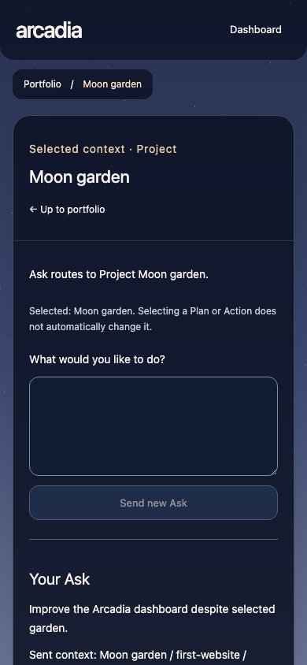
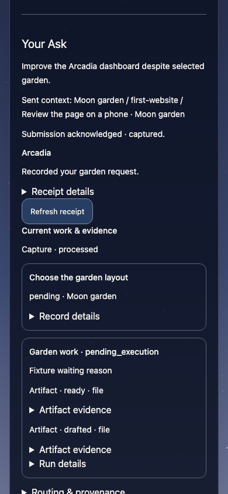
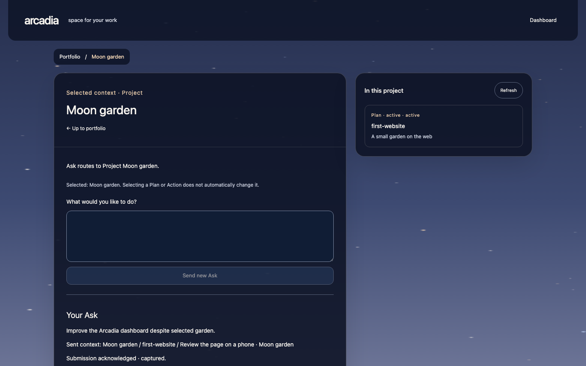
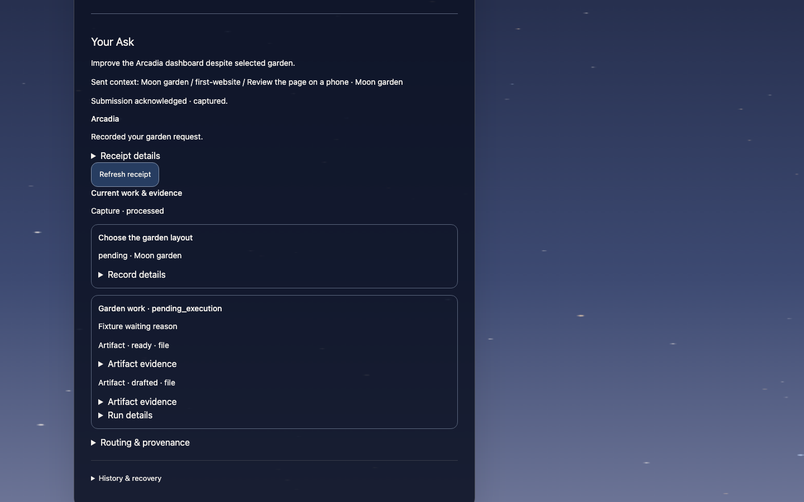

# Workspace Ask receipt loop — implementation evidence

Extension: [Open linked Artifacts](workspace-artifact-opening.md) implements
image/text viewing from these cards. Artifact-delivery deferrals below describe
the original PR #1440 snapshot; the new guide gives current limits and evidence.

Operator-directed continuation, intake #1438. Candidate: `codex/workspace-ask-integration`, base `e63ef8c734c6321e203ace84f125a7c20d73d233`, worktree `/Users/pmark/.codex/worktrees/workspace-ask-integration/arcadia`. Implementer role, depth 1, sole product writer; Lead owns independent review, preservation and delivery. This assignment creates no managed Action, claim, enrollment, authority or completion. Current unrelated pointer was rechecked as `claude-worker-launch-replay` in the active production Plan. Parent supplied the clean-candidate/monitor overlap evidence before edits. No primary or other candidate changed.

## Delivered behavior

- Project navigation supplies the loaded portfolio database ID. Optional POST `projectId` is strictly validated; exact read-only membership validation precedes CLI intake, then `--project <id>` is forwarded. Existing unscoped Capture remains supported. Request text is unchanged. Unknown Project never falls back to routing.
- One layout-mounted provider holds the visible exchange, draft and target across workspace navigation. In-flight text, Project, selected context and request identity remain pinned. Unsent drafts keep their original target until the operator explicitly changes it.
- The browser attempts storage synchronously before transport. A lost response triggers a GET receipt lookup first. Only a confirmed missing receipt offers an unchanged original-payload retry. A changed draft receives a new ID only after explicit Send. A direct receipt URL and reload only read; they never POST. Browser storage refusals and invalid stored shapes are visible; malformed recovery bytes remain untouched through automatic reads until deliberate edits/send.
- The brief reply is the actual POST summary. Refresh failures retain acknowledgment and label retained evidence as the last successful read. Cards show correlated outcomes, current Run statuses, reasons, linked Artifact evidence references, partial captures, ignored acknowledgments and empty states. IDs/provenance live in disclosures. No absolute path or `artifact:id` is fabricated into a download URL; generic Artifact delivery remains a follow-up.
- Composer and exchange lead the phone layout. Navigation has a scoped dark surface so pale sky cannot erase the labels. The existing persistent sky renderer remains unchanged. Plan/Action selection provides visible context only; it is not an implicit amendment or execution-ID mapping.

## Validation and raw receipts

Raw logs are local `/tmp` receipts, not committed artifacts. The Lead must verify them independently and obtain fresh read-only review; this document does not claim PR acceptance.

| Command | Exit / observed result | Raw log |
| --- | --- | --- |
| `pnpm exec vitest run tests/ask-api-boundaries.test.ts tests/ask-api-scenarios.test.ts` | 0; 31 passed after the scoped service-status repair | `/tmp/workspace-ask-api-tests-final.log` |
| `pnpm exec eslint` with the eight touched TypeScript/TSX files | 0; final frozen source and fixture | `/tmp/workspace-ask-lint-final.log` |
| `pnpm build` | 0; core build plus repository lint (before final UI/service-status refinements, covered by final focused lint/dashboard build) | `/tmp/workspace-ask-build.log` |
| `pnpm exec tsc -p apps/dashboard/tsconfig.json --noEmit --incremental false` | 2; existing test-file diagnostics only: operator-script route test, pull-request-audio, inventory-client, summary; no changed-module diagnostic | `/tmp/workspace-ask-dashboard-tsc.log` |
| `pnpm fast-rehearsal` (unmodified harness) | 0; 19 files, 72 pass and 1 expected fail; 34 scenarios, 4m52s; report has 49 errors, **2 tagged unexpected**, both the session-probe-wall fixture EROFS stop (log and launch). Not a clean-error report. | `/tmp/workspace-ask-fast-rehearsal.log` |

Fast rehearsal report exists at `/var/folders/cm/0dn1wl093f52lr7h5d7xpdn40000gn/T/arcadia-fast-rehearsal-report-kxaG5x/report.json`; mixed unsandboxed/Seatbelt fixture validators are reported by the harness. No report classification was changed.

The first production browser pass was exit 0 (one journey, 9.7s), `/tmp/workspace-ask-browser.log`. It covers context navigation/late reply, pinned draft/target, stable stored pre-transport ID, duplicate click, changed draft identity, unchanged retry, read failure with retained acknowledgment, reload GET only, partial capture, current Run states/no Runs, evidence references without download links, invalid saved-shape preservation, storage refusal, unavailable randomUUID fallback, and responsive width. Final named contrast repair adds viewport screenshots and explicit keyboard/disabled-invalid-context assertions; its last build/browser results follow below.

## Limits and next safe step

No live workspace/provider mutation, production launch, service restart, candidate commit/push/settlement, merge, deployment or messaging occurred. Fast rehearsal uses its existing disposable fixture Git commits/remotes and fake providers only. Browser APIs were intercepted; real API scenarios used disposable temporary workspaces. No physical-phone, deployed latency, full conversation backend, scoped Plan/Action AI grounding or generic Artifact delivery is claimed. The full workspace MVP remains incomplete.

The Lead should verify the final diff/logs/screenshots, perform independent read-only review, update the canonical operator guide in the coordinated candidate, and preserve/open the authorized PR. Stop at any real permission/authority boundary. Existing standalone dashboard test-type diagnostics are reported without weakening checks.

## Retrieval evidence

Read the supplied AGENTS contract and the following instruction sources (UTF-8 file byte sizes, not token counts):

- `.agents/skills/arcadia-role/SKILL.md`: 8539 bytes.
- `.agents/skills/arcadia-guardrail/SKILL.md`: 5565 bytes.
- `CONSTITUTION.md`: 3320 bytes.
- `PROJECT.md`: 31677 bytes.
- `.arcadia/AGENT_CONTEXT_POLICY.md`: 539 bytes.
- `.arcadia/repo-context.md`: 703 bytes.
- `.arcadia/context-policy.json`: 870 bytes.
- `docs/agent-guidance/index.json`: 9449 bytes.
- `docs/agent-guidance/operator-directed-work.md`: 4494 bytes.
- `docs/agent-guidance/learning.md`: 1927 bytes.
- `docs/working-copy-safety.md`: 15818 bytes.
- `docs/agent-guidance/pull-requests.md`: 17585 bytes.
- `docs/arcadia-semantics.md`: 15647 bytes.
- `docs/AGENT_ORIENTATION.md`: 13594 bytes.
- `docs/agent-guidance/standard-harness.md`: 5569 bytes.
- `docs/agent-guidance/session-roles-and-briefs.md`: 6152 bytes.

Targeted reads also included active Plan `claude-worker-launch-replay`, Notes To Self “What happened to an Ask?”, “Bridge dependencies”, “Run one Vitest file”, repository guidance Orientation/Semantics/Operator Guide/PR QA/Working-Copy Safety, the pinned handoff `docs/reports/handoffs/20261015T0621Z-01a13dbc-5c50-7ef1-b48b-a9678ff4fb9b.md`, and fast-rehearsal README isolation/real-versus-fake contract. Notes lookup repeated for lint/build/service symptoms. Arcadia role and guardrail skills applied; no child delegation.

## Friction

- First touched lint found an unnecessary type assertion in the newly added route field. Removed it; focused lint passed. No dependency workaround was used.
- The first dashboard build was started before fresh core `dist` existed and failed resolving the exported Intelligence client. Preserved `/tmp/workspace-ask-dashboard-build.log`; corrected dependent build ordering. Subsequent dashboard builds passed. This was a build-order mistake, not a product defect.
- Full-page screenshots taken while scrolled only paint the fixed canvas in its current viewport; white regions are not sky parity evidence. Prior captures are preserved under `/tmp/workspace-ask-visual-before`; final visual proof uses deliberately positioned viewport captures. A named header contrast repair adds backing without changing sky rendering.

- A new scoped service-error regression proved the direct read-only Project preflight initially returned HTTP 500 for a missing workspace, instead of the bridge’s established HTTP 503. `/tmp/workspace-ask-scoped-service-before.log` retains the failing assertion. The preflight now translates Arcadia errors through the existing status mapping; its focused regression and the full API scenario suite are rerun below.

## Final frozen check results and handback

- Final `pnpm dashboard:build`: exit 0, `/tmp/workspace-ask-dashboard-build-final.log`, after the contrast and service-status repairs.
- Final `pnpm exec playwright test tests/e2e/workspace-shell.spec.ts`: exit 0, one journey in 7.2s, `/tmp/workspace-ask-browser-final.log`. Added keyboard tab reachability, disabled composer on invalid context, and successful GET recovery after uncertain POST with storage refused.
- Final touched-file ESLint: exit 0, `/tmp/workspace-ask-lint-final.log`. `git diff --check`: exit 0.
- Populated final viewport captures were visually inspected at 390×844 and 1440×900: navigation, composer, acknowledgment and work cards are readable; no horizontal overflow. Files under `test-results/playwright/workspace-shell-workspace--67681-pe-and-Ask-receipt-recovery/`: `workspace-ask-phone-top.png`, `workspace-ask-phone.png` (reply/work), `workspace-ask-desktop-top.png`, `workspace-ask-desktop.png` (reply/work). These are production-build UI fixtures, not live-workspace or deployed evidence.
- Lead source inspection attributes the two fast-rehearsal unexpected labels to the deliberately injected `EROFS` in `tests/fast-rehearsal/session-probe-wall.test.ts:31`; the test expects the environment-wall stop. Preserve the report-label caveat, with any report-classification follow-up owned by Lead.

The candidate remains uncommitted by explicit assignment. Sole-writer ownership is handed back to Lead after this evidence; no independent acceptance/review is claimed. Lead owns guide/QA/ledger/assets, independent review and authorized delivery. No governed work record changed. Stop condition is any unresolved review finding or real permission/authority boundary.

Frozen product/test SHA-256 (proof document excluded to avoid self-reference):

- `apps/dashboard/app/api/ask/route.ts`: `be58ce4cb408490354581b5942b67fbe0e4a9015f4e11cdd6f8bc823d7049a62`
- `apps/dashboard/app/workspace/layout.tsx`: `27e1625c933012cfd60532f15ffdfeca7e0e8fb8a7f63a60a4a20d12efe98137`
- `apps/dashboard/app/workspace/workspace.css`: `a150179c77b8e0462d0d4222a8275a2ff3291a3109ea19030cc512d5e6625abf`
- `apps/dashboard/components/workspace/workspace-view.tsx`: `9a9df7b147cbf58ee3030a1c87ad5580fc9adb516ee1b73921f15334e782bcbf`
- `apps/dashboard/components/workspace/workspace-ask.tsx`: `89c92bb5cc02ad89e8732d4187754afb27a3493a6a4ca838ec4f439990e53078`
- `apps/dashboard/lib/arcadia-cli.ts`: `05e17e765c66759dcf2c57dff75a8774a3e9d8598630a1bac30f32f3b12a5197`
- `tests/ask-api-boundaries.test.ts`: `deed95f62ff41e7b099ea0e0cf7e4ca20d63f2e4e42b2bcddcbd5b3d9436ddc2`
- `tests/ask-api-scenarios.test.ts`: `aab88e12c536a5df9c00942631cb9194789f04079dc8995ac78daaa4d051dad9`
- `tests/e2e/workspace-shell.spec.ts`: `6aace2a6987246a3ca81e66ccb30359b6a829e0272e57676ab0a52fcaa453610`

## Operator QA and next slice

Start the dashboard and open `/workspace`. Choose a Project, optionally navigate
to its Plan/Action, and verify the displayed Ask target. Submitting is a real
Ask through the existing safe execution rules; use an intended request. During
submission, navigate elsewhere: the pending request must retain its original
Project. Inspect the brief reply, current work/status, and Receipt details.
Refresh the receipt; reload its link and confirm no second submission appears.
At phone width, tab through navigation, textarea, Send and receipt controls.
The automated failure/retry/storage scenarios use disposable fixtures; do not
simulate failures by changing a live workspace.

Next proposed slice: one verified, access-controlled Artifact delivery adapter
so the output shown by an Ask can actually be opened on a phone. Revival trigger:
acceptance of this receipt loop and a specific output Artifact selected for the
MVP journey. Plan/Action grounding and synchronized conversation history remain
separate proposals. No new governed Action is claimed by this document.

Parent independently reran four focused files on the final bridge: **50 tests
passed**, exit 0, 25.24s (`/tmp/workspace-ask-parent-tests-final.log`). The earlier
parent run reproduced the scoped HTTP 500 defect before its repair; its failed
receipt remains `/tmp/workspace-ask-parent-tests.log`. Parent visual inspection
verified the phone top and reply/work viewport captures. Initial independent
browser rerun exposed a fixture completion race before corrupt-storage injection;
its failed receipt is retained at `/tmp/workspace-ask-parent-browser.log`.

Current implementation screenshots use intercepted, hypothetical Moon garden
records, not live requests. The four viewport assets show top/composer and
reply/work views on phone and desktop:

Parent final production-browser rerun: **passed**, one journey in 5.7s, exit 0
(`/tmp/workspace-ask-parent-browser-final.log`). The fixture now awaits the
preceding submission's completion before injecting malformed saved state. No
product change was needed. Session ledger and diff checks passed. The existing
report-label defect is tracked as [#1322](https://github.com/pmark/arcadia/issues/1322);
its revival trigger is the harness reporting repair, not this UI slice.

Lead refreshed the no-PR work monitor before guide edits. Other candidates'
historical changes include other START_HERE sections; no active writer overlap
with this workspace-specific section was established. No other checkout was
edited. The parent primary reflog remains ef6c83e47, 7bbfbed07, f6de70bec.

## Independent review and CI repairs

PR [#1440](https://github.com/pmark/arcadia/pull/1440), first head
`05e989d6496f59e2d4ca65e7911913cdf17aad9c`: independent read-only round 1
found one blocking P2. Opening receipt B replaced saved exchange A without
retaining A in History. A regression failed before the fix. Shared bounded,
deduplicated selection now retains A and restores B's known original metadata;
the test verifies preserved draft/target, GET-only navigation and A's unchanged
retry. Implementer production-browser verification passed in 6.1s; raw logs
`/tmp/workspace-ask-deeplink-{before,lint,build,browser}.log`.

First-head CI exposed eager core imports breaking unrelated bridge consumer
mocks in PR description, approval and production-reactivation tests. These
imports now load only inside scoped Ask validation. No mocks or CI gates were
weakened. Implementer PR-description + API tests passed 37/37, approval tests
2/2, focused lint and final production dashboard build passed. Raw logs:
`/tmp/workspace-ask-lazy-import-{tests,approve,lint,build}.log`.

CI also rejected the Lead's post-check ledger value `handed_off`: its schema
allows complete, split or stopped. The row now uses `split` because Artifact
delivery remains a separate MVP slice. This corrects the record, not the
validator. Failed CI logs are retained as `/tmp/workspace-ask-ci-*-failed.log`.
The revised commit requires fresh independent delta review and all seven CI
jobs before merge. No production or shared checkout action is implied.

Parent post-repair verification: **60 tests passed across seven focused files**,
exit 0, 28.38s, including all three CI-affected bridge consumers and source-CLI
Ask scenarios (`/tmp/workspace-ask-parent-post-review-tests.log`). Final
production-browser regression passed in 7.3s, exit 0
(`/tmp/workspace-ask-parent-post-review-browser.log`).
